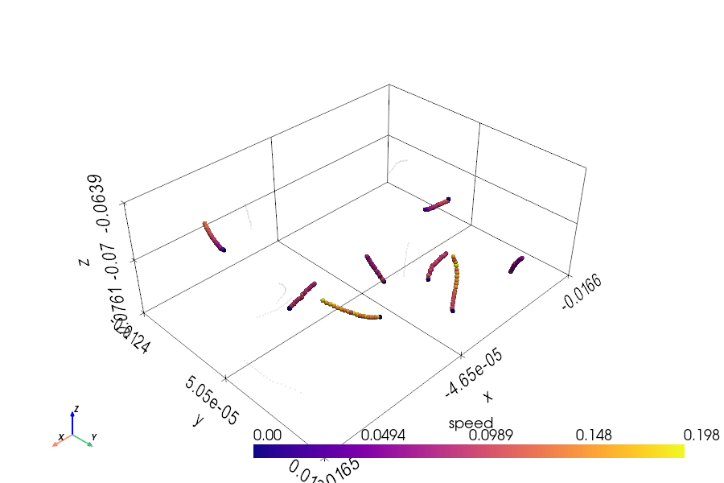

# Flowtracks — post-processing of 3D-PTV data

Flowtracks is a Python package for post-processing 3D Particle Tracking
Velocimetry (3D-PTV) trajectory databases: reading per-frame particle data,
building trajectories, interpolating Lagrangian data onto Eulerian grids,
phase and ensemble averaging for periodic flows, smoothing, stitching, and
ParaView/VTK export. It is one stage of the OpenPTV multi-repo pipeline
(see below).

**Latest release:** <https://pypi.org/project/flowtracks/>
**Tests:** `uv run pytest`

The full documentation is maintained in the
[`doc/`](doc/index.rst) Sphinx sources (build with
`python -m sphinx -b html doc _build/html`), and is also hosted on
[Read the Docs](https://flowtracks.readthedocs.io).

## Installation

```bash
pip install flowtracks
```

Optional extras:

```bash
pip install "flowtracks[vtk]"       # ParaView export (pyvista + vtk)
pip install "flowtracks[legacy-io]" # legacy PyTables HDF5 reader
pip install "flowtracks[flux]"      # centerline flux (scikit-image)
pip install "flowtracks[netcdf]"    # NetCDF export (netcdf4)
pip install "flowtracks[notebooks]" # marimo/Jupyter notebooks environment
```

Requires Python ≥ 3.11. Core dependencies: numpy, scipy, h5py, pyyaml,
zarr ≥ 3.0.0, xarray ≥ 2024.1.0 and matplotlib. See `pyproject.toml` for the
full list.

For developers — clone the repository and install it editable:

```bash
git clone https://github.com/OpenPTV/postptv
cd postptv
uv sync --group dev      # or: pip install -e ".[vtk]"
```

## Interoperability with MyPTV, proPTV and OpenLPT

The `flowtracks.myptv`, `flowtracks.proptv` and `flowtracks.openlpt`
readers convert the three 3D-PTV tracking pipelines into flowtracks
:class:`~flowtracks.trajectory.Trajectory` objects — or directly into a Zarr
store that `ZarrScene` reads natively, so their results are combined and
post-processed in postptv:

```python
from flowtracks.myptv import convert_myptv_to_zarr
from flowtracks.proptv import convert_proptv_to_zarr
from flowtracks.openlpt import convert_openlpt_to_zarr

convert_myptv_to_zarr("smoothed_trajectories", "myptv_run.zarr")
convert_proptv_to_zarr("tracks.hdf5", "proptv_run.zarr")
convert_openlpt_to_zarr("ConvergeTrack", "openlpt_run.zarr")
```

For pyOpenLPT (the `openlpt` package), the `convert_pyopenlpt_to_zarr`
alias records `source_format="pyopenlpt"` on the same store. See
[`doc/myptv.rst`](doc/myptv.rst),
[`doc/proptv.rst`](doc/proptv.rst) and
[`doc/openlpt.rst`](doc/openlpt.rst) for the file formats and semantics,
and [`examples/openlpt_tracks_example.py`](examples/openlpt_tracks_example.py)
for a runnable tour.

## From OpenPTV data to a picture

The first 20 frames of the OpenPTV tracer data shipped with flowtracks
(`data/tracers`, ptv_is format, 500 fps) converted to a Zarr store and
rendered with `flowtracks.graphics.plot_trajectories_3d`:



```python
from flowtracks.io import trajectories, save_zarr_trajectories
from flowtracks.graphics import plot_trajectories_3d, select_trajectories
import pyvista as pv

trajs = trajectories("data/tracers/ptv_is.%d", first=10001, last=10020,
                     frate=500.0, traj_min_len=20)
save_zarr_trajectories(trajs, "openptv_run.zarr", overwrite=True)
sel = select_trajectories("openptv_run.zarr", by="length", n=8)
plotter = pv.Plotter(off_screen=True)
plot_trajectories_3d("openptv_run.zarr", trajids=sel, context=2000,
                     plotter=plotter, show=False)
plotter.screenshot("openptv_tracks.png", window_size=(900, 600))
```

## Quick start

```python
from flowtracks.io import trajectories
from flowtracks.zarr_scene import ZarrScene
from flowtracks.eulerian import eulerian_grid

trajs = trajectories("my_run.zarr")        # format inferred from the filename
scene = ZarrScene("my_run.zarr")           # a Zarr-backed Scene
ds = eulerian_grid(scene, grid_params, 0, 2)  # bin into an Eulerian grid
```

Further narrative material (recipes, the math, the marimo story) lives in
`docs/`:

- [`docs/eulerian_statistics.md`](docs/eulerian_statistics.md) — per-run vs pooled statistics
- [`docs/story/`](docs/story/index.html) — marimo-studio story of the pipeline

Examples, notebooks and the marimo demo live in [`examples/`](examples/).

## Repository layout

| Path | What it is |
|------|-----------|
| `flowtracks/` | the package (see `CONTRIBUTING.md` for the module map) |
| `doc/` | Sphinx documentation (API reference + guides) |
| `docs/` | narrative docs: Eulerian statistics guide + marimo story |
| `examples/` | runnable scripts and marimo/Jupyter notebooks |
| `tests/` | the test suite (`uv run pytest`) |
| `scripts/` | analysis scripts and helpers |

## License

`flowtracks` combines two licenses. The original core — `trajectory`, `particle`,
`sequence`, `scene`, `analysis`, `io`, `smoothing`, `interpolation`, `pairs`,
`graphics`, `format_docstrings`, `phasing`, `lyapunov` and `__init__` — is
under the **GNU GPL v3.0** (see `LICENSE.txt`). Newer modules — the Zarr
backend and the xarray post-processing track and the related BSD-3-Clause
modules (`zarr_scene`, `eulerian`, `phase_average`, `pipeline`, `combine`,
`stitching`, `repair`, `writers`, `provenance`, `vortex`, `wall_shear`,
`flux`, `nhist`, `clean`, `merge`) — are **BSD-3-Clause**
(see `LICENSES/BSD-3-Clause.txt`). Every module states its license in an
SPDX header at the top of the file. The package as a whole combines both, so
a distributed `flowtracks` follows GPL-3.0 terms; the BSD modules are
reusable under BSD only when used standalone, without the GPL core.

## How to cite this work

Meller, Y and Liberzon, A 2016. "Particle Data Management Software for 3D
Particle Tracking Velocimetry and Related Applications – The Flowtracks
Package." *Journal of Open Research Software*, 4: e23.
DOI: <https://doi.org/10.5334/jors.101>
