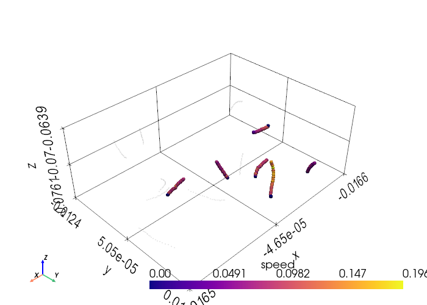
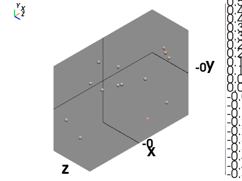

Getting Started
================

Installation
--------------

.. code:: bash

   pip install flowtracks

Optional extras (install the ones you need):

.. code:: bash

   pip install "flowtracks[vtk]"       # ParaView export (pyvista + vtk)
   pip install "flowtracks[legacy-io]" # legacy PyTables HDF5 reader (``tables``)
   pip install "flowtracks[flux]"      # vessel centerline flux (scikit-image)
   pip install "flowtracks[netcdf]"    # NetCDF export (netcdf4)
   pip install "flowtracks[notebooks]" # marimo/Jupyter notebooks environment

The core install requires Python ≥ 3.11 and pulls in numpy, scipy, h5py,
pyyaml, zarr ≥ 3.0.0, xarray ≥ 2024.1.0 and matplotlib.

For development, clone the repository and install it editable:

.. code:: bash

   git clone https://github.com/OpenPTV/postptv
   cd postptv
   uv sync --group dev      # or: pip install -e ".[vtk]"

Quickstart
----------

Reading and saving trajectories:

.. code:: python

   from flowtracks.io import trajectories, save_zarr_trajectories

   trajs = trajectories("my_data.zarr")       # format inferred from filename
   for traj in trajs:
       print(traj.trajid, len(traj))

   save_zarr_trajectories(trajs, "clean.zarr", overwrite=True)

A standard post-processing flow (Lagrangian → Eulerian → phase average):

.. code:: python

   from flowtracks.zarr_scene import ZarrScene
   from flowtracks.eulerian import eulerian_grid, save_zarr

   scene = ZarrScene("my_data.zarr")
   ds = eulerian_grid(scene, grid_params, 0, 2)
   save_zarr(ds, "grid.zarr", overwrite=True)

Exporting to ParaView (requires the ``vtk`` extra):

.. code:: python

   from flowtracks.writers import write_eulerian_series

   write_eulerian_series(ds, "paraview_out")

Running the test suite
----------------------

.. code:: bash

   uv run pytest

Examples
--------

The ``examples/`` directory ships runnable notebooks:

* ``examples/hdf5_scene_analysis.ipynb`` — a tutorial to the basic HDF5
  analysis workflow.
* ``examples/repeated_interpolation.ipynb`` — a demonstration of the
  ``flowtracks.interpolation`` module.

Additional examples live in the
`flowtracks_examples <https://github.com/alexlib/flowtracks_examples>`_
repository.

Analysis script
---------------

The script ``scripts/analyse_fhdf.py`` runs a full analysis from a config
file. Usage::

  uv run python scripts/analyse_fhdf.py --help

A config file looks like::

   [Particle]
   density = 1450
   diameter = 500e-6

   [Scene]
   particles file = particles.h5
   tracers file = tracers.h5
   first frame = 10001
   last frame = 10200
   frame rate = 500

See the ``data/`` directory for matching sample data.

A first plot
------------

Read a run, pick the longest trajectories and draw them in 3D:

.. code:: python

   from flowtracks.io import trajectories, save_zarr_trajectories
   from flowtracks.graphics import plot_trajectories_3d, select_trajectories
   import pyvista as pv

   trajs = trajectories("data/tracers/ptv_is.%d", first=10001, last=10020,
                        frate=500.0, traj_min_len=20)
   save_zarr_trajectories(trajs, "run.zarr", overwrite=True)
   sel = select_trajectories("run.zarr", by="length", n=6)
   plotter = pv.Plotter(off_screen=True)
   plot_trajectories_3d("run.zarr", trajids=sel, context=1000,
                        plotter=plotter, show=False)
   plotter.show()

Animation
---------

Animate the same run frame by frame (writes PNG frames, optionally an MP4
with ffmpeg):

.. code:: python

   from flowtracks.graphics import animate_trajectories_3d

   animate_trajectories_3d(
       "run.zarr",
       out_dir="frames/",
       movie="trajectories.mp4",   # requires ffmpeg on PATH
       frames=None,                # animate every frame of the source
       label="frame {frame}",
   )
