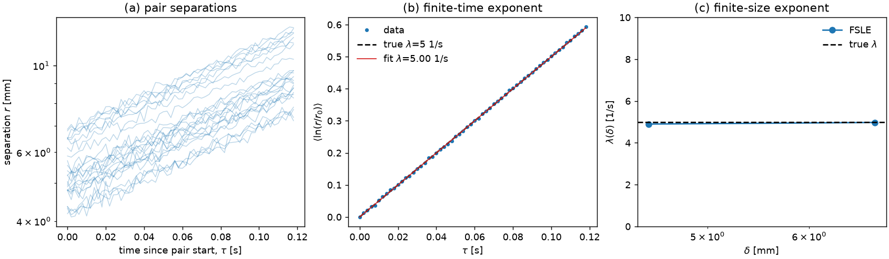
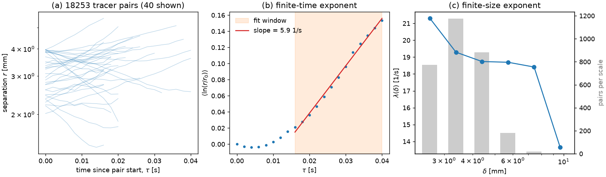
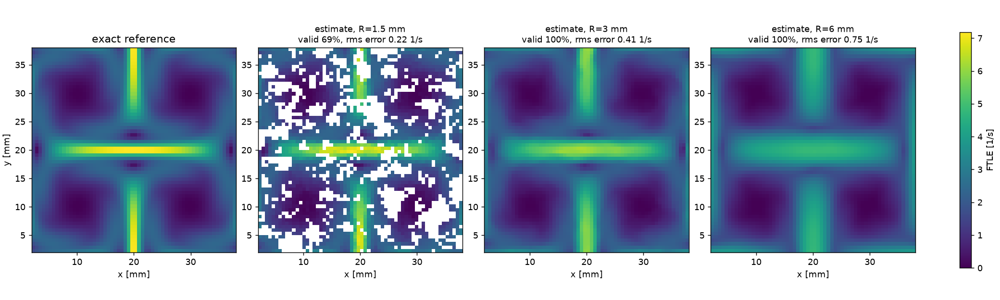
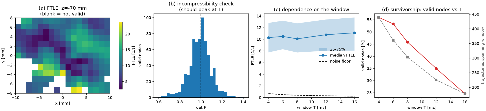
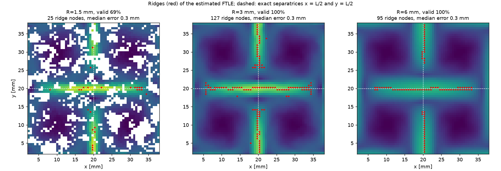

Lyapunov exponents: ``flowtracks.lyapunov``
============================================

.. contents::
   :local:
   :depth: 2

Overview
--------

The module estimates how fast neighbouring fluid elements separate, from
Lagrangian trajectories. Three estimators are provided, which answer
**different questions** and should not be expected to agree:

==========================  ==============================  ==========================================
Function                    Quantity                        Output
==========================  ==============================  ==========================================
``finite_time_lyapunov``    mean exponential growth rate    one number plus the growth curve
                            of pair separation (FTLE of
                            pair dispersion)
``finite_size_lyapunov``    FSLE: growth rate as a          one value per length scale ``delta``
                            function of separation scale
``eulerian_ftle``           FTLE *field* on a grid, from    3D field, with per-node diagnostics
                            the flow-map gradient
``ftle_ridges``             ridges (candidate LCS) of an    boolean mask on the same grid
                            FTLE field
==========================  ==============================  ==========================================

All three take a list of :class:`~flowtracks.trajectory.Trajectory` objects
whose ``time()`` holds **integer frame numbers**, and return an
:class:`xarray.Dataset`. Positions are in metres. The time between frames is
given by the argument ``dt`` [s].

The figures on this page are produced by ``examples/lyapunov_demo.py``
(``uv run python examples/lyapunov_demo.py``). The real-data figures use the
tracers in ``data/tracers`` (500 fps, two-phase turbulence experiment, see
``data/readme.txt``).

.. warning::

   Lyapunov exponents from PTV data are easy to compute and easy to get wrong.
   The numbers depend on the measurement noise, on which particles happen to be
   tracked for long enough, and on choices of scale and window made by the
   user. Read :ref:`lyapunov-cautions` before quoting a value.

Quick start
-----------

.. code-block:: python

    from flowtracks.io import trajectories_ptvis
    from flowtracks import lyapunov

    trajs = trajectories_ptvis('data/tracers/ptv_is.%d', first=10001,
                               last=10200, frate=500, traj_min_len=8)
    dt = 1 / 500

    # Pair-based exponent: pairs that start 2-4 mm apart, fit lags 8..20.
    ftle = lyapunov.finite_time_lyapunov(
        trajs, r_min=2e-3, r_max=4e-3, dt=dt, max_lag=20, fit_lags=(8, 20),
        min_overlap=8)
    print(float(ftle.lyapunov), 'per second')

    # Finite-size exponent, thresholds 2 mm * 1.3**n.
    fsle = lyapunov.finite_size_lyapunov(
        trajs, 2e-3, 4e-3, ratio=1.3, num_scales=8, dt=dt, min_overlap=8)

    # Eulerian FTLE on a grid, window from frame 10050 to 10056.
    import numpy as np
    grid = (np.linspace(-0.01, 0.01, 17), np.linspace(-0.008, 0.008, 13),
            np.linspace(-0.08, -0.06, 9))
    field = lyapunov.eulerian_ftle(
        trajs, grid, 10050, 10056, radius=6e-3, dt=dt, position_error=20e-6)
    good = field.ftle.where(field.valid)       # NaN where not trustworthy

Pair-based estimators
---------------------

Method
~~~~~~

Both pair-based estimators start from the same step (:func:`find_pairs`):

1. Every frame is scanned with a KD-tree. A pair of trajectories is *accepted*
   at the first frame in which both exist and their separation is within
   ``[r_min, r_max]``. That frame is the pair's start, ``r(0) = r0``.
2. A pair is kept only if it shares at least ``min_overlap`` frames from its
   start on.
3. The separation ``r(tau)`` is followed over the frames in which both
   trajectories exist (:func:`pair_separations`). Lag ``tau`` is the offset
   from the start frame.

Note that pair selection picks **any** two particles that happen to be close,
not particles known to be neighbours for a reason. In a real flow that is the
point (it is how pair dispersion is defined), but in a synthetic test it means
unrelated particles must be kept far apart, or they enter as spurious pairs
that do not separate (we found this the hard way: with 150 synthetic pairs
packed in a 10 cm box, 95 spurious pairs appeared and biased the exponent from
5.0 to 3.3).

Finite-time exponent
~~~~~~~~~~~~~~~~~~~~

For each lag the average of the logarithmic growth, :math:`\langle \ln
(r(\tau)/r_0) \rangle`, is taken over all pairs that still exist at that lag.
If the separation grows exponentially, :math:`r = r_0 e^{\lambda \tau}`, that
average is a straight line of slope :math:`\lambda`, and the exponent is the
least-squares slope over the window ``fit_lags``.

Synthetic check (known :math:`\lambda = 5\ \mathrm{s^{-1}}`, 150 pairs, position
noise 0.1 mm, 500 fps): the estimate is **5.0004** :math:`\mathrm{s^{-1}}`.

Panel (b) shows the curve and the fit; (c) shows that the FSLE of a pure
exponential is flat and equal to :math:`\lambda`. Only two scales appear
because these pairs start at 4-7 mm, and a pair cannot be timed from a
threshold below its initial separation.

On the real tracers (:math:`r_0` = 2-4 mm, 18253 pairs, fit window 8-20 frames
= 16-40 ms):

* Panel (b) is **not** a straight line from the start. For the first ~8 frames
  the mean log growth is flat or slightly negative: at these small scales and
  short times the relative motion is not an exponential separation, and
  measurement noise at small ``r0`` also contributes. Fitting lags 1-6 gives
  about 1.1 :math:`\mathrm{s^{-1}}`; fitting lags 8-20 gives 5.9
  :math:`\mathrm{s^{-1}}`. The window **is** the answer; choose it by looking
  at this curve, and report it.
* The number of pairs falls with lag (18253 at lag 0, 1779 at lag 20) because
  tracks end. The pairs at long lags are the ones whose tracks lived long.

Finite-size exponent
~~~~~~~~~~~~~~~~~~~~

Thresholds :math:`\delta_n = r_{min}\rho^n` are laid out, with
:math:`\rho` = ``ratio``. For each pair that starts below :math:`\delta_n`, the
first-passage times (linearly interpolated between frames) at which the
separation reaches :math:`\delta_n` and :math:`\rho\delta_n` are measured. Their
difference is :math:`T(\delta_n)`. Then

.. math::

    \lambda(\delta_n) = \frac{\ln \rho}{\langle T(\delta_n) \rangle}

with the average over pairs that completed the amplification. Unlike the
finite-time exponent it does not depend on a window, and is not tied to one
initial separation. It is what to use to ask *at which scale* separation is
exponential (:math:`\lambda` is constant in :math:`\delta`) and at which it is
not.

The real-data result in panel (c) above is about 18-21 :math:`\mathrm{s^{-1}}`
at :math:`\delta` = 2.6-7.4 mm. The number of pairs that completed the
amplification is 772, 1175, 881, 182 and 20 at those scales, and only 2 at the
last point (9.7 mm, value 13.7), which should be disregarded. This **does not agree** with the 5.9
:math:`\mathrm{s^{-1}}` of the finite-time estimate, and it should not be
expected to. The most likely reason is a selection effect specific to the FSLE
with short tracks: a pair counts only if it was tracked long enough to complete
the amplification, so pairs that separate *slowly* tend to drop out before
they are counted. Treat the absolute FSLE values from short tracks as an upper
bound until checked on longer data.

Parameters
~~~~~~~~~~

``r_min``
    Must be **well above the position error**. Position noise is amplified in
    the ratio :math:`r/r_0` at small separations, which biases the exponent. As
    a rule of thumb, take ``r_min`` at least 20 times the position error.
``r_max``
    Controls how many pairs there are. Larger gives more statistics but mixes
    scales; the finite-time exponent then averages over a range of
    :math:`r_0`.
``max_lag`` / ``fit_lags``
    Choose the fit window from the curve (see above), not by default.
    The default window (lag 1 to the longest) is only appropriate if the curve
    is straight from the start, as in the synthetic case.
``min_overlap``
    Pairs shorter than this are discarded. Raising it removes noisy short pairs
    but increases the survivorship bias.

Eulerian FTLE
-------------

.. note::

   The Eulerian FTLE is the least robust estimator in this module, and the
   one most likely to produce attractive but meaningless pictures. The function
   is deliberately conservative: it returns NaN wherever a check fails, and
   returns diagnostics next to every value. **Do not use the FTLE values
   without looking at the diagnostics.**

Definition
~~~~~~~~~~

Let :math:`\Phi_{t_0}^{t_0+T}` be the *flow map*: it takes the position
:math:`\mathbf{x}_0` of a fluid particle at time :math:`t_0` to its position
:math:`\mathbf{x}_1` at time :math:`t_0+T`. The *deformation gradient* is

.. math::

    F = \frac{\partial \Phi}{\partial \mathbf{x}_0}, \qquad
    F_{ji} = \frac{\partial x_{1,j}}{\partial x_{0,i}},

and the right Cauchy-Green tensor is :math:`C = F^{\mathsf T} F`. The FTLE at
:math:`\mathbf{x}_0` is

.. math::

    \mathrm{FTLE}(\mathbf{x}_0; t_0, T) =
        \frac{1}{|T|}\ln\sqrt{\lambda_{\max}(C)}
        = \frac{1}{|T|}\ln \sigma_{\max}(F),

the largest stretching rate of an infinitesimal material line that starts at
:math:`\mathbf{x}_0`. A *negative* window (:math:`t_{end} < t_{start}`) gives
the **backward** FTLE. Ridges of the forward FTLE field are commonly used as
indicators of repelling Lagrangian coherent structures, and ridges of the
backward field as attracting ones. The field is "Eulerian" because it is
reported on a fixed grid of initial positions :math:`\mathbf{x}_0`.

Properties worth keeping in mind (they are used in the diagnostics below):

* For an **incompressible** flow, :math:`\det F = 1`, so :math:`\sigma_{\max}
  \ge 1` and the exact FTLE is **never negative**.
* For a short window, :math:`F \approx I + T\nabla\mathbf{u}`, and the FTLE
  tends to the largest eigenvalue of the **strain-rate tensor** :math:`S =
  \tfrac12(\nabla\mathbf{u}+\nabla\mathbf{u}^{\mathsf T})`. In that limit the
  result is *not* a Lagrangian-transport quantity at all, only the
  instantaneous strain rate; rotation does not contribute at first order.
* FTLE is a property of a **finite window**. Changing :math:`t_0` or :math:`T`
  changes the field, and for unsteady flow there is no "true" value to
  converge to.

How it is estimated from PTV data
~~~~~~~~~~~~~~~~~~~~~~~~~~~~~~~~~

PTV does not measure the flow map on a grid. It measures positions of
scattered particles. :func:`eulerian_ftle` proceeds as follows:

1. **Scattered flow map** (:func:`flow_map`). Keep only the trajectories that
   exist at *both* ``t_start`` and ``t_end``. Their positions at these two
   frames are the pairs :math:`(\mathbf{x}_0^{(i)}, \mathbf{x}_1^{(i)})`.
2. **Neighbourhoods.** For every grid node :math:`\mathbf{g}`, collect the
   particles with :math:`|\mathbf{x}_0^{(i)}-\mathbf{g}| < R` (``radius``).
3. **Local linear fit.** Fit, by weighted least squares,

   .. math::

       \mathbf{x}_1^{(i)} \approx \mathbf{b} + F\,(\mathbf{x}_0^{(i)} -
       \mathbf{g}),

   with tricube weights :math:`w_i = (1-(r_i/R)^3)^3`. The fitted :math:`F`
   is the deformation gradient at the node, and the offset :math:`\mathbf{b}`
   is the (smoothed) displacement.
4. **FTLE** :math:`= \ln\sqrt{\lambda_{\max}(F^{\mathsf T}F)}/|T|`.
5. **Validity checks and diagnostics** (next section), evaluated per node.

Differentiating noisy scattered data is what makes this estimator delicate:
:math:`F` is a *derivative* of the measured map.

Validity checks
~~~~~~~~~~~~~~~

A node's results are NaN, and ``valid`` is ``False``, unless **all** of these hold:

``n_points >= min_neighbors``
    At least ``min_neighbors`` (default 12; the fit has 4 coefficients per
    component, so 5 is the absolute minimum) particles in the neighbourhood.
``condition <= max_condition``
    The ratio of the largest to the smallest singular value of the (weighted,
    centred) neighbour offsets. A value near 1 means the neighbours surround
    the node isotropically. A large value means they lie in a plane, or on
    a line, and :math:`F` is not determined in some direction. Default 10.
centroid offset :math:`\le` ``max_offset`` :math:`\cdot R`
    The weighted centroid of the neighbours must be close to the node. Where
    the data ends (edge of the measurement volume, or a hole without
    tracers), the fit extrapolates rather than interpolates, and the result
    is biased. For tricube weights a node exactly at a straight data edge has
    an offset of 0.27 :math:`R`, a node outside the data has more, and a full
    neighbourhood has about 0. Default 0.25, so nodes at or beyond the edge
    are rejected, as are very lopsided sparse neighbourhoods.

Diagnostics returned with the field
~~~~~~~~~~~~~~~~~~~~~~~~~~~~~~~~~~~

``det_F``
    For incompressible flow it must be 1. Its distance from 1 is a measure of
    how wrong :math:`F` is, caused by noise, by the flow map not being linear
    over :math:`R`, or by a poor neighbourhood. This is the most useful
    single check, and it is free. **Mask FTLE values where ``det_F`` is far
    from 1** (for example, outside 0.8-1.2 for the example below), and make
    that criterion explicit in whatever you publish. Note that it is a
    necessary condition, not a sufficient one: a wrong :math:`F` can still
    have :math:`\det F \approx 1`.
``fit_residual_rms`` [m]
    The weighted RMS of the local-fit residuals. If it is much larger than the
    position error, the flow map is **not** linear at the scale :math:`R` (or
    there is a data problem), and the FTLE is dominated by the model error.
``ftle_noise_floor`` [1/s] (if ``position_error`` is given)
    A first-order estimate of how much the FTLE is uncertain due to position
    noise alone. Computed from the fit itself: the covariance of the least
    squares coefficients, :math:`\sigma^2 M^{-1}(A^{\mathsf T}W^2A)M^{-1}` with
    :math:`M=A^{\mathsf T}WA`, the typical error of one entry of :math:`F`,
    divided by :math:`|T|`. FTLE values not well above this floor are noise.
    This floor does **not** include the model error (see ``fit_residual_rms``),
    the survivorship bias, or errors in ``position_error`` itself, which is
    an input you must supply and justify.
``n_points``, ``condition``
    As above.

Validation on a known flow
~~~~~~~~~~~~~~~~~~~~~~~~~~

The estimator was tested against the exact answer using a steady 2D
Taylor-Green flow (cell width 20 mm, :math:`T` = 0.4 s) seeded with 40000
random particles carrying 20 :math:`\mu\mathrm{m}` position noise. The
reference was computed from the exact flow map by finite differences. The
nodes are on a plane through the seeded slab.

The three estimates differ **only in** ``radius``, and show the central
trade-off of the method:

* **R = 1.5 mm.** Spatial resolution is good and the ridges are sharp, but
  neighbourhoods are small and noisy, and 31% of the nodes (white) are
  rejected by the validity checks.
* **R = 3 mm.** All nodes valid, RMS error 0.41 :math:`\mathrm{s^{-1}}`
  against a ridge value of about 7. The ridge is already visibly wider and lower
  than the exact one. (The R = 1.5 mm RMS error, 0.22, is lower only because it
  is computed over the 69% of nodes that were not rejected; the comparison of
  errors across radii is not like for like.)
* **R = 6 mm.** The field looks smooth and complete, which is exactly the
  danger: it is **smeared**, the ridge peak is underestimated by roughly a
  third, and the RMS error is the largest (0.75 :math:`\mathrm{s^{-1}}`).
  A larger radius always gives a prettier picture, not a more accurate one.

The linear fit has a bias that grows with :math:`R` (the flow map's curvature,
which for large :math:`T` is concentrated exactly at the ridges) and a variance
that grows as :math:`R` shrinks. There is no setting that is right for all
flows.

Real tracers
~~~~~~~~~~~~

The same estimator on the real tracers (window 10050 to 10056, i.e. 6 frames =
12 ms, :math:`R` = 6 mm, assumed position error 20 :math:`\mu\mathrm{m}`):

What this shows, and what it does not:

* Only **225 of 14035** trajectories span the 12 ms window, and **35%** of
  the grid nodes (696 of 1989) pass the validity checks (median 21 particles
  in the neighbourhood). Panel (d): the longer the window, the fewer the
  survivors and valid nodes. Panel (a) has holes where the checks failed.
* Panel (b): the median :math:`\det F` is 1.00, with a spread of about
  0.82-1.16 (5th-95th percentile). The incompressibility check is passed in
  the median, with a spread of order 15%. That is a reasonable sign, not a
  proof.
* The median FTLE is about 10.8 :math:`\mathrm{s^{-1}}` (5th-95th percentile
  4.3-17.8), and it is **almost independent of the window** in panel (c),
  from 4 to 16 ms. This is what the theory above predicts for a window much
  shorter than any flow time scale: the value is essentially the largest
  strain rate, not a finite-time Lagrangian exponent. It carries no Lagrangian
  coherent structure information.
* The noise floor is about 0.3 :math:`\mathrm{s^{-1}}`, so position noise at
  the assumed level is not the limiting factor. But the median
  ``fit_residual_rms`` is about **440 :math:`\mu\mathrm{m}`**, more than twenty
  times the assumed position error: the flow map is **not** well described by
  a linear fit over 6 mm. The dominant uncertainty is the model, not the noise,
  and the noise floor is therefore an optimistic bound.
* The real tracks are too short for anything but this near-instantaneous
  limit. To get actual finite-time FTLE ridges, much longer trajectories are
  needed (or stitching, see :mod:`flowtracks.stitching`; stitching adds its
  own uncertainty, which is not propagated here).

Ridge extraction
----------------

Ridges of the forward (backward) FTLE field are the usual candidates for
repelling (attracting) Lagrangian coherent structures (LCS): the barriers that
organise transport. :func:`ftle_ridges` extracts them from the output of
:func:`eulerian_ftle`.

.. warning::

   An FTLE ridge is **not** the same thing as an LCS. It is neither necessary
   nor sufficient (a ridge can sit on a region of strong shear that no fluid
   crosses transversally, and a genuine LCS can be missed by a ridge
   criterion). It is a *candidate*. What is found also depends on the window,
   the radius, the smoothing and the thresholds. And the field underneath
   inherits every caution of the Eulerian FTLE above.

Definition
~~~~~~~~~~

The *second-derivative* ridge definition is used. Let :math:`f` be the (smoothed)
FTLE field, :math:`H = \nabla\nabla f` its Hessian and :math:`\mathbf{n}` the
eigenvector of :math:`H` with the most negative eigenvalue :math:`\ell_{\min}`.
A point is on a ridge if

.. math::

    \nabla f \cdot \mathbf{n} = 0
    \qquad\text{and}\qquad \ell_{\min} < 0,

that is, :math:`f` is stationary and concave across the ridge. In 2D the
ridges are curves, in 3D surfaces. They are found on the grid as follows:

1. **Smoothing.** The field is smoothed with a Gaussian (``smooth``, in grid
   nodes), using only valid nodes (a normalised convolution, so holes do not
   pull the field toward zero). Differentiating twice amplifies noise, so some
   smoothing is required; it also widens ridges and can move them.
2. **Hessian.** By finite differences on the grid (so the grid must be regular),
   giving :math:`\mathbf{n}` and :math:`\ell_{\min}` at every node.
3. **Non-maximum suppression.** The discrete form of :math:`\nabla f\cdot
   \mathbf{n}=0`: a node is kept if :math:`f` there is not smaller than
   :math:`f` one grid step away on either side along :math:`\mathbf{n}`
   (linearly interpolated). This yields ridges one node thick.
4. **Thresholds.** Only nodes with :math:`\ell_{\min} < -` ``min_curvature`` and
   :math:`f \ge` ``min_ftle`` are kept. Without a threshold on :math:`f`, every
   weak maximum in the noise is a "ridge". By default ``min_ftle`` is a
   percentile (``min_percentile``) of the valid values: this is a choice about
   how much of the field you call a ridge, not a statement about the physics.
   Prefer to give an absolute ``min_ftle`` that you can justify (for instance
   from the ``ftle_noise_floor``).
5. **Border.** The outermost layer of nodes never carries a ridge, because a
   maximum cannot be verified without neighbours on both sides. Before this was
   added, the test below produced false ridges along the grid edge.

Singleton dimensions are ignored, so a single plane of a 3D grid gives ridge
lines, and a volume gives ridge surfaces.

Validation on a known flow
~~~~~~~~~~~~~~~~~~~~~~~~~~

The same Taylor-Green setup as above: its separatrices (the lines where the
FTLE ridges must be) are known exactly, :math:`x, y \in \{0, L/2, L\}` with
:math:`L` = 40 mm. The full chain is exercised: noisy scattered particles, then
:func:`eulerian_ftle`, then :func:`ftle_ridges`.

* **R = 3 mm and 6 mm:** the ridge nodes (127 and 95) lie on the separatrices
  with a median error of 0.3 mm, a small fraction of the radius, and the cross
  is recovered.
* **R = 1.5 mm:** only 25 scattered nodes, because 31% of the field is invalid
  (white): the neighbourhoods are too sparse. Few and fragmentary ridges are the
  result, not a poor extractor.
* **What is missed.** The ridges stop short of the ends of the lines, where the
  FTLE falls below the threshold, and there is a gap at the crossing. At a
  crossing the Hessian has two equally negative eigenvalues, so the normal
  direction is not defined, and the criterion fails there. Ridge junctions are
  not captured by this method.

The automated tests (``tests/test_lyapunov.py``) check the extractor on
analytic fields (a line, a tilted line with noise, a cross, a plane in 3D, a
valley that must not be reported, fields with holes, flat and monotonic fields
that must give nothing), and the whole chain on the Taylor-Green flow: at least
95% of the ridge nodes within one radius of a separatrix, median error under
half a radius, and most of the interior separatrix nodes with a ridge nearby.

The real tracers give no ridges
~~~~~~~~~~~~~~~~~~~~~~~~~~~~~~~

On the real tracers (the 12 ms window and R = 6 mm of the Eulerian section) the
extractor finds **1 ridge node**. As a control, shuffling the FTLE values
randomly over the same valid nodes, 50 times, gives on average 1.9 (range 0-6).
So the result is indistinguishable from chance. This is the expected outcome:
at that window the FTLE is essentially a strain rate (see above), and there is
no coherent structure for the ridge to find. Ridges from such a field should not
be reported. Control experiments of this kind (a shuffled or noise-only field
through the same pipeline) are a good habit for any ridge claim.

.. _lyapunov-cautions:

Cautions (please read)
----------------------

These apply to all three estimators unless stated.

**Measurement noise biases the exponent upward.**
    Zero-mean errors do not average out: the largest singular value of a matrix
    is a convex function of its entries, so errors in :math:`F` increase
    :math:`\sigma_{\max}` on average. Pair estimators have the same problem at
    small :math:`r_0`. The error is therefore not symmetric: noisy data
    produces *larger* exponents. Use ``position_error`` and keep the scales
    well above it.

**Survivorship bias.**
    Every estimator here uses only the particles that were tracked for the
    whole window (or pair lifetime). Tracks are lost where the flow is most
    interesting: fast, strongly strained regions, high out-of-plane motion, or
    where the seeding is dense and ambiguous. The surviving sample is not a
    random sample of the flow, and the direction of the resulting bias is not
    known in general. The FSLE is especially exposed (see the real-data
    comparison above), and so is the Eulerian FTLE: the valid nodes are not a
    random subset of the grid either. Always report the number of trajectories
    used (it is stored in ``attrs``) and the fraction of valid nodes.

**Only valid nodes mean something; coverage is not uniform.**
    Do not fill the NaN nodes in by interpolation, and do not average the field
    over the domain without saying what was excluded. The valid region is
    biased towards where the seeding is dense.

**The result depends on the window and on the radius.**
    The Eulerian FTLE depends on :math:`t_0`, on :math:`T` and on :math:`R`;
    the pair estimators depend on the fit window and on ``r_min``/``r_max``.
    Show the dependence (as in panels (c) and (d) of the real-data figure) before
    claiming a value. A value that changes when the window changes is
    telling you something about the window.

**A short window gives the strain rate, not a Lagrangian exponent.**
    See the definition section. Ridges and Lagrangian coherent structures only
    appear when :math:`T` is long compared to the strain time-scale, i.e.
    when :math:`\lambda T` is of order 1 or more. PTV trajectories are often
    shorter than that.

**The estimate is for the tracers, not necessarily for the fluid.**
    Inertial particles do not follow the flow map of the fluid. Use tracers.

**Time dependence.**
    For unsteady flow, FTLE ridges are not material barriers in a strict
    sense. They are indicators. The ridge extraction itself (e.g. ridge
    tracking, thresholds on :math:`\nabla\mathrm{FTLE}`) is not done here and
    requires its own care.

**Ridges are candidates, and depend on the thresholds.**
    See the ridge section. Report ``smooth``, ``min_ftle`` (or the percentile)
    and the window. Run a control (shuffled or noise-only field) before
    interpreting a ridge, as done there for the real tracers.

**No built-in notion of truth.**
    ``det_F``, ``fit_residual_rms`` and the noise floor catch several failure
    modes but not all. In particular, a smooth but wrong field (too large
    :math:`R`, in the validation figure) can pass every check. When
    possible, validate on a synthetic flow with the same seeding density,
    noise and track lengths as the real data, as done above.

Recommended workflow for the Eulerian FTLE
~~~~~~~~~~~~~~~~~~~~~~~~~~~~~~~~~~~~~~~~~~

1. Count the trajectories that span your window (``flow_map``) before doing
   anything else. If there are not at least a few hundred over the volume,
   stop.
2. Pick :math:`R` so that the neighbourhoods hold at least ~20-30 particles
   and so that :math:`R` is clearly smaller than the structures you hope to
   see. Try three values of :math:`R` and compare, as in the validation figure.
3. Look at ``valid``, ``det_F`` and ``fit_residual_rms`` **before** looking at
   the FTLE. Mask on ``det_F`` and state the criterion.
4. Compare with ``ftle_noise_floor``.
5. Repeat for several windows and several start frames.
6. Validate on synthetic data built to mimic your experiment.
7. Only then extract ridges, with an absolute threshold, and run a control.

Reference
---------

.. automodule:: flowtracks.lyapunov
   :members:
