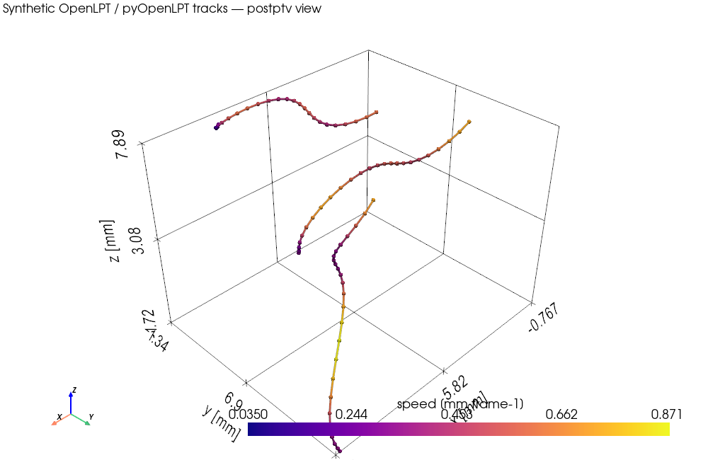

Importing OpenLPT / pyOpenLPT data
===================================

:mod:`flowtracks.openlpt` reads the track output of **OpenLPT_GUI** or the
**pyOpenLPT** package (`openlpt` on PyPI) and converts it into flowtracks
:class:`~flowtracks.trajectory.Trajectory` objects — or directly into a
``trajectories`` Zarr store that :class:`~flowtracks.zarr_scene.ZarrScene`
reads natively, with no further conversion. `pyOpenLPT
<https://github.com/alexlib/pyOpenLPT>`_ is a packaging fork of the same
software with an identical C++ core and identical output (verified), so
there is exactly one reader for both: :func:`read_openlpt_tracks` plus
``read_pyopenlpt_tracks`` / ``convert_pyopenlpt_to_zarr`` aliases with
``source_format="pyopenlpt"`` provenance recorded.

OpenLPT writes each stage as a family of CSV files under ``Results/ConvergeTrack/``
— named ``{LongTrackActive,ShortTrackActive,LongTrackInactive,ExitTrack}_{frame}.csv``
— with a header row and one row per track sample:

- Tracer: ``[TrackID, FrameID, WorldX, WorldY, WorldZ, camX, camY, ...]``
- Bubble: ``[TrackID, FrameID, WorldX, WorldY, WorldZ, R3D, camX, camY, camRpx, ...]``

Positions are millimetres. Frame IDs are integers. Velocity and acceleration
are not stored in these files; the translator re-derives velocity as finite
differences over the frame column (mm per frame). Acceleration is not
guessed. Unparseable rows are skipped. Track ids are re-assigned in a running
offset so they are unique across the whole directory, mirroring the GUI's own post-processing. Because the offset advances by ``max_id + 1`` per file, ids may not be contiguous when the source ids are sparse. Bubble files additionally surface a
``radius`` property (not projected into the Zarr store).

A self-contained example — synthetic tracks, run in a temporary directory:

.. code:: bash

   python examples/openlpt_tracks_example.py

.. code:: python

   from flowtracks.openlpt import convert_openlpt_to_zarr
   from flowtracks.graphics import plot_trajectories_3d
   import pyvista as pv

   convert_openlpt_to_zarr("ConvergeTrack", "openlpt_run.zarr")
   plotter = pv.Plotter(off_screen=True)
   plot_trajectories_3d("openlpt_run.zarr", context=1000, plotter=plotter, show=False)
   plotter.screenshot("openlpt_tracks.png", window_size=(900, 600))

   Synthetic example — three tracks with drift and sinusoidal wander,
   converted by :func:`convert_openlpt_to_zarr` and rendered with
   :func:`flowtracks.graphics.plot_trajectories_3d`.

.. automodule:: flowtracks.openlpt
   :members:
   :private-members:
