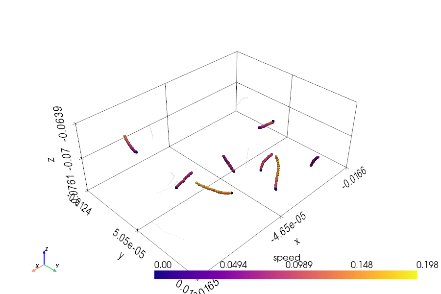

Importing OpenPTV data
=======================

:mod:`flowtracks` reads OpenPTV output natively — OpenPTV is the canonical
source format the rest of the pipeline is built around. Every other importer
in this section (MyPTV, proPTV, OpenLPT) converts into the same
``trajectories`` Zarr layout, so the downstream Eulerian / phase-averaging /
export stages are identical regardless of where the tracks came from.

Supported input formats (inferred from the file name by
:func:`flowtracks.io.infer_format`):

* **ptv_is** — OpenPTV's per-frame output: one file per frame with position,
  previous/next-frame index and particle number.
* **xuap** — one file per frame with position, velocity and acceleration for
  the particle and the surrounding fluid.
* **acc** — like xuap, with the time step relative to the trajectory start.
* **mat** — Matlab file of trajectory structure-arrays.
* **hdf** — flowtracks' own HDF5 format (PyTables). Needs the ``legacy-io``
  extra.
* **npz** — NumPy archive of trajectory data.
* **zarr** — Zarr ``trajectories/`` group (see :doc:`zarr_scene`).

.. code:: python

   from flowtracks.io import trajectories, save_zarr_trajectories
   from flowtracks.zarr_scene import ZarrScene

   # Read OpenPTV output (format inferred from the file name)
   trajs = trajectories("run_0000.ptv_is")

   # Optional: rewrite as a Zarr store that ZarrScene opens natively
   save_zarr_trajectories(trajs, "run.zarr", overwrite=True)

   scene = ZarrScene("run.zarr")

See :doc:`getting_started` for the full post-processing flow and
:doc:`io` for the complete reader/writer API.

From file to picture
====================

The figure below shows the first 20 frames of the OpenPTV tracer data
shipped with flowtracks (``data/tracers``, ptv_is format, 500 fps)
converted to a Zarr store by :func:`flowtracks.io.save_zarr_trajectories`
and rendered with :func:`flowtracks.graphics.plot_trajectories_3d` — a 3D
view of the 8 longest linked trajectories, coloured by speed
(stored per-frame velocity). Faint grey points show the rest of the cloud
for context.

.. code:: python

   from flowtracks.io import trajectories, save_zarr_trajectories
   from flowtracks.graphics import plot_trajectories_3d, select_trajectories
   import pyvista as pv

   trajs = trajectories("data/tracers/ptv_is.%d", first=10001, last=10020,
                        frate=500.0, traj_min_len=20)
   save_zarr_trajectories(trajs, "openptv_run.zarr", overwrite=True)
   sel = select_trajectories("openptv_run.zarr", by="length", n=8)
   plotter = pv.Plotter(off_screen=True)
   plot_trajectories_3d("openptv_run.zarr", trajids=sel, context=2000,
                        plotter=plotter, show=False)
   plotter.screenshot("openptv_tracks.png", window_size=(900, 600))

   Trajectories from OpenPTV's tracer data, recovered through postptv.

