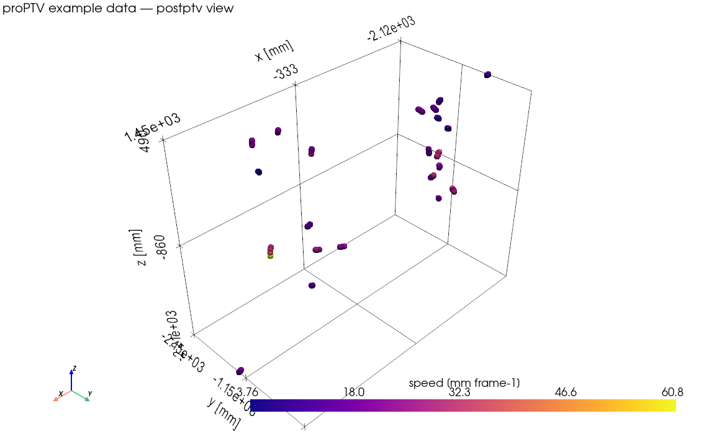

Importing proPTV data
=====================

:mod:`flowtracks.proptv` reads proPTV track output and converts it into
flowtracks :class:`~flowtracks.trajectory.Trajectory` objects — or directly
into a ``trajectories`` Zarr store that
:class:`~flowtracks.zarr_scene.ZarrScene` reads natively, with no further
conversion. This is the interop bridge between `proPTV
<https://github.com/RobinBarta/proPTV>`_ (the probabilistic tracker) and
flowtracks (the post-processing pipeline): proPTV tracks, postptv
post-processes.

proPTV saves each pipeline stage as a float64 HDF5 file under
``data/{case}/output/tracks/tracks*.hdf5`` (for example ``tracks.hdf5`` or
``tracks_initial.hdf5``). Each track is a dataset named
``track_{t}_{key}`` (``t`` = last frame of the track, ``key`` = track
index) with columns::

    [frame, x, y, z, vx, vy, vz, ax, ay, az, <cx, cy> * n_cameras]

i.e. 10 + 2*n_cameras columns. Positions appear in millimetres (the track
volumes in proPTV configs, e.g. ``[-2500, 2500]`` per axis). The file
records no units of its own. Frame numbers are integers stored as floats.
The per-camera 2D projection columns are ignored — only the 3D Lagrangian
data enters the Zarr store.

.. code:: python

   from flowtracks.proptv import read_proptv_hdf5, convert_proptv_to_zarr

   trajects = read_proptv_hdf5("tracks_initial.hdf5")
   convert_proptv_to_zarr("tracks_initial.hdf5", "run.zarr")

   # ZarrScene opens the converted store with no conversion step:
   from flowtracks.zarr_scene import ZarrScene
   scene = ZarrScene("run.zarr")

``convert_proptv_to_zarr`` writes a ``trajectories`` group with ``pos``,
``vel``, ``time``, ``trajid`` and ``accel`` — the same layout as the MyPTV
import and ``openptv2``'s RunStore, so it is consumed by flowtracks'
Eulerian/phase-averaging pipeline directly. Units default to honest
per-frame units (``mm frame-1``, ``mm frame-2``) — the source file records no
units and no frame rate, so ``units=`` is passed to state absolute units
explicitly. A ``source_format``/``source_file``/``source_path`` attribute
pair is recorded on the group for provenance.

   proPTV's own example tracks (``tracksinitial.hdf5``, 848 4-sample
   tracks), converted via :func:`convert_proptv_to_zarr` and rendered with
   :func:`flowtracks.graphics.plot_trajectories_3d`. 22 tracks spread across
   the volume, colored by speed in ``mm frame-1``.

.. automodule:: flowtracks.proptv
   :members:
   :private-members:
