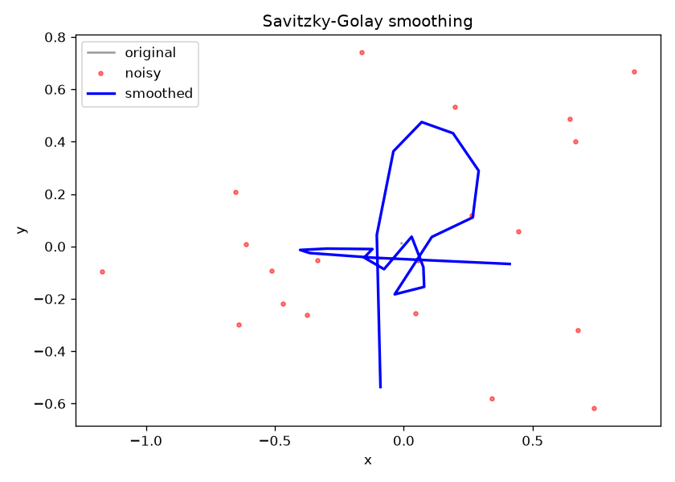

Reference for the smoothing module
==================================

.. automodule:: flowtracks.smoothing
   :members:

From file to picture
====================

The figure below shows a single OpenPTV trajectory (``data/tracers``) with
added noise, smoothed with
:func:`flowtracks.smoothing.savitzky_golay` (window 11, order 3). The
smoothed curve recovers the underlying path while preserving its shape
better than a moving average.

.. code:: python

   from flowtracks.io import trajectories
   from flowtracks.smoothing import savitzky_golay
   import numpy as np

   trajs = trajectories("data/tracers/ptv_is.%d", first=10001, last=10020,
                         frate=500.0, traj_min_len=20)
   t = max(trajs, key=lambda x: len(x))
   noisy_pos = t.pos() + np.random.default_rng(0).normal(0, 0.5, t.pos().shape)
   from flowtracks.trajectory import Trajectory
   noisy = Trajectory(noisy_pos, t.velocity(), t.time(), t.trajid())
   smoothed = savitzky_golay([noisy], fps=500.0, window_size=11, order=3)[0]
