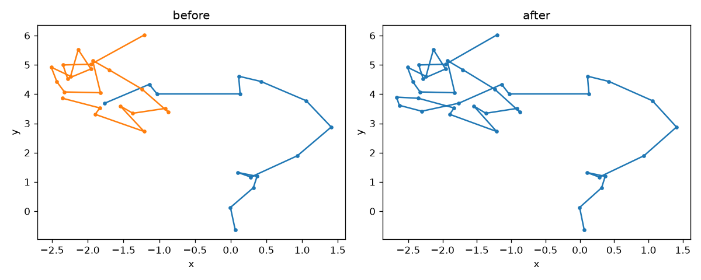

Stitching
=========

:mod:`flowtracks.stitching` reconnects broken trajectory segments across
short frame gaps: candidates are matched between the end of one segment and
the start of the next, then accepted when the candidate is the unique nearest
neighbour — a linear-sum-assignment-based matching.

- :func:`flowtracks.stitching.stitch_trajectories` — the standard pass
- :func:`flowtracks.stitching.stitch_trajectories_fast` — a fast variant
  that skips per-candidate validation

Stitching is one of the steps in :mod:`flowtracks.clean`; it is also
available standalone.

.. automodule:: flowtracks.stitching
   :members:

From file to picture
====================

The figure below shows two broken segments of one trajectory (left) being
reconnected by :func:`flowtracks.stitching.stitch_trajectories` across a
short frame gap (right), with the gap interpolated.

.. code:: python

   from flowtracks.trajectory import Trajectory
   from flowtracks.stitching import stitch_trajectories
   import numpy as np

   seg1 = Trajectory(pos1, vel1, t1, 1)
   seg2 = Trajectory(pos2, vel2, t2, 2)
   stitched = stitch_trajectories([seg1, seg2], fps=1.0,
                                  max_gap=5, max_distance=5.0)
